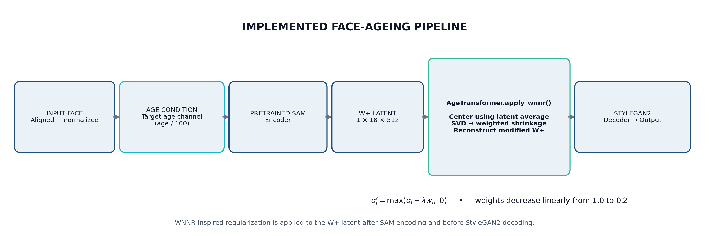

# Face Ageing and De-ageing Using Conditional StyleGAN with WNNR-Inspired Latent-Space Regularization

A face-ageing and de-ageing research project built on the **pretrained Style-based Age Manipulation (SAM)** framework and its StyleGAN2 decoder. The project adds a **WNNR-inspired SVD-based latent-space regularization** operation to the SAM inference pipeline.

> **Research scope:** This repository extends pretrained SAM during inference. It does not train SAM from scratch or claim that the WNNR-inspired step has proven improvements in identity preservation, age accuracy, or perceptual image quality.

## Overview

The application accepts an aligned face image and a target age, generates a baseline SAM output, and optionally applies weighted singular-value shrinkage to the encoded W+ latent before decoding it with StyleGAN2.

## Architecture



Pipeline:
1. Align and preprocess the input face.
2. Create a target-age conditioning channel (target age scaled by 100) and concatenate it with the RGB input.
3. Pass the conditioned image through the pretrained SAM encoder.
4. Obtain the W+ latent representation (`[1, 18, 512]`).
5. Call `AgeTransformer.apply_wnnr()` to center, decompose, shrink and reconstruct the latent.
6. Decode the modified latent with the pretrained StyleGAN2 generator.
7. Compare the regularized image with the baseline SAM image using SSIM and PSNR.

## WNNR-inspired latent regularization

Let `W+` be the encoded latent and `W_avg` be the model's latent average.

**Centering**

`Z = W+ - W_avg`

**SVD**

`Z = U Σ Vᵀ`

**Weighted shrinkage**

`σ'_i = max(σ_i - λ w_i, 0)`

The implementation uses a linearly decreasing weight sequence from `1.0` to `0.2`. The regularization strength `λ` controls shrinkage.

**Reconstruction**

`W'+ = U Σ' Vᵀ + W_avg`

The reconstructed latent is sent to the pretrained StyleGAN2 decoder.

### Code integration

The WNNR-inspired operation is implemented as the `apply_wnnr()` method inside:

`datasets/augmentations.py` → `AgeTransformer`

The Streamlit application imports `AgeTransformer` and calls this method on the SAM encoder's W+ latent. The method acts on the latent representation, not on the RGB image or age channel.

## Features

- Face image upload and preprocessing/alignment
- Target-age selection
- Baseline SAM image generation
- Optional WNNR-inspired latent regularization
- Adjustable regularization strength (`λ`)
- StyleGAN2 decoding of the modified latent
- SSIM and PSNR comparison against baseline SAM output
- Separate experimental dashboard for recorded experiment results

## Repository structure

```text
SAM/
├── datasets/
│   └── augmentations.py       # AgeTransformer and apply_wnnr()
├── face_ageing_app/
│   ├── app.py                 # Streamlit face-ageing application
│   └── experiment_dashboard.py
├── criteria/
│   └── wnnr_loss.py           # WNNR-inspired regularization utilities (if used by experiments)
├── experiments/               # Recorded experimental data / plots
├── models/
├── scripts/
├── configs/
└── pretrained_models/         # Model weights are not committed to GitHub
```

Actual files may vary slightly by project revision.

## Requirements

- Python environment compatible with the original SAM repository
- PyTorch and the dependencies specified by the SAM implementation
- Streamlit
- scikit-image
- dlib and face-alignment dependencies used by the project
- A GPU is recommended for practical inference
- The pretrained SAM checkpoint and dlib landmark predictor

## Setup

1. Clone this repository:

   ```bash
   git clone https://github.com/Aravind-dyapa/face-ageing-stylegan.git
   cd face-ageing-stylegan
   ```

2. Install the dependencies required by the original SAM implementation and the additional application packages:

   ```bash
   pip install streamlit scikit-image
   ```

   Install the remaining packages according to the SAM repository's environment instructions. `dlib` installation may require platform-specific setup.

3. Obtain the pretrained SAM checkpoint and place it at:

   ```text
   pretrained_models/sam_ffhq_aging.pt
   ```

4. Place the 68-point dlib landmark predictor at the path expected by the application:

   ```text
   shape_predictor_68_face_landmarks.dat
   ```

   These large model assets are excluded from this repository and must be obtained separately from their respective sources / project setup.

5. Confirm the paths in `face_ageing_app/app.py`, then run:

   ```bash
   cd face_ageing_app
   streamlit run app.py
   ```

For Google Colab, restore the project and model assets to the expected `/content/SAM` directory before launching Streamlit.

## Evaluation

SSIM and PSNR in the current application compare the WNNR-regularized output against the baseline SAM output for the same input and target age.

Previously recorded example comparisons:

| Regularization strength (λ) | SSIM | PSNR |
|---:|---:|---:|
| 0.5 | 0.99543 | 42.73 dB |
| 2.0 | 0.97137 | 31.90 dB |

These are example observations from a limited experiment, not aggregate benchmark results. Higher SSIM / PSNR here indicates greater similarity to the baseline output; it does **not** by itself establish better image quality, identity preservation, or target-age accuracy.

## Limitations

- Current quantitative experiments are preliminary and cover a limited number of inputs and settings.
- SSIM and PSNR are baseline-similarity measures in this setup.
- Identity preservation and target-age accuracy require separate metrics and validation.
- Generalization, demographic fairness and robustness have not yet been established.
- The project uses pretrained SAM / StyleGAN2 weights and does not claim model training or fine-tuning.

## Future work

- Identity similarity evaluation using ArcFace embeddings
- Target-age alignment using an independent age estimator
- Larger and more diverse evaluation set
- Baseline comparisons with alternative regularization methods
- Ablation of λ and singular-value weight schedules
- Reporting averages, variance and failure cases

## References

- SAM paper: *Only a Matter of Style: Age Transformation Using a Style-Based Regression Model* (Alaluf, Patashnik & Cohen-Or, 2021).
- Original SAM repository: https://github.com/yuval-alaluf/SAM

## Acknowledgement

This project builds on the research and pretrained implementation of SAM. The WNNR-inspired latent regularization is an experimental extension implemented for this project.
